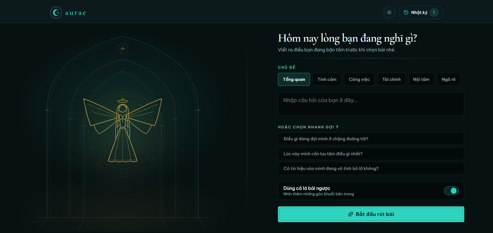
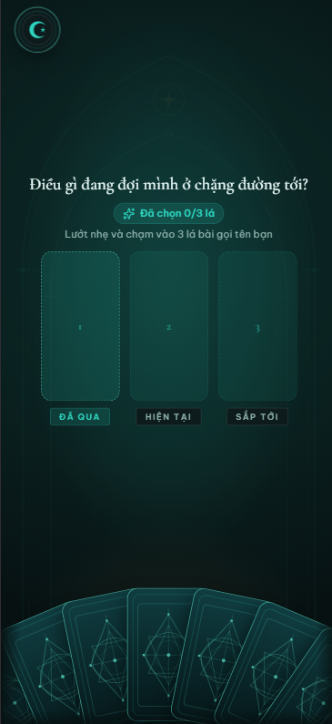
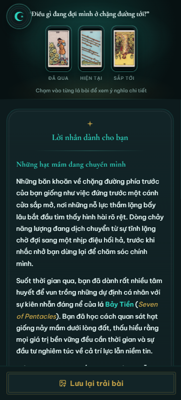
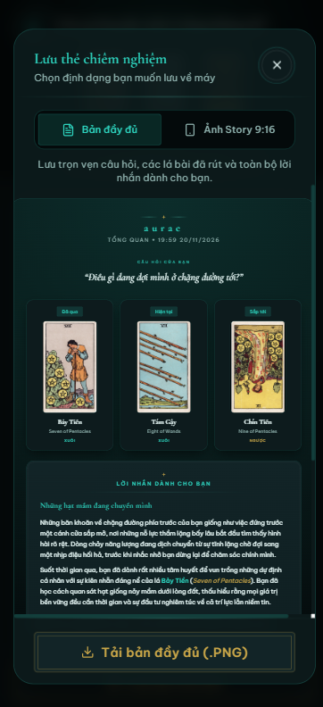

# aurae

Ứng dụng web trải bài Tarot tối giản, tập trung vào trải nghiệm nhẹ nhàng và tự chiêm nghiệm. Thay vì mang màu sắc huyền bí nặng nề, **aurae** được thiết kế như một góc nhỏ yên tĩnh để bạn chậm lại vài phút, đặt câu hỏi và lắng nghe suy nghĩ của chính mình.

**Trải nghiệm trực tiếp:** [https://aurae-tarot.vercel.app](https://aurae-tarot.vercel.app/)



## Tính năng chính

- **6 chủ đề gần gũi:** Tổng quan, Tình cảm, Công việc, Tài chính, Nội tâm và Ngã rẽ (so sánh hai lựa chọn), đi kèm các câu hỏi gợi ý sẵn và tùy chọn bật/tắt lá bài ngược.
- **Trình tự trải bài trọn vẹn:** Bắt đầu bằng vài nhịp thở điều hòa, tráo đủ 78 lá bài và lướt chọn trực tiếp trên trải bài vòng cung.
- **Luận giải mạch lạc & Hỏi thêm:** Hiển thị lời nhắn tổng quan cho 3 lá bài chính, cho phép chạm vào từng lá để xem từ khóa chi tiết và rút thêm tối đa 2 lá làm rõ cho các câu hỏi phát sinh.
- **Xuất ảnh lưu niệm (PNG):** Hỗ trợ tải về 2 định dạng ảnh chất lượng cao là **Bản đầy đủ** (lưu toàn bộ nội dung buổi trải bài) và **Ảnh Story 9:16** (tinh gọn để chia sẻ).
- **Nhật ký cá nhân & Giao diện Sáng/Tối:** Tự động lưu lại lịch sử các lần trải bài ngay trên trình duyệt, không cần tạo tài khoản.

## Hình ảnh giao diện

|                Rút bài vòng cung                |               Không gian đọc lời nhắn                |            Thẻ lưu niệm & Story 9:16             |
| :---------------------------------------------: | :--------------------------------------------------: | :----------------------------------------------: |
|  |  |  |

## Công nghệ sử dụng

- **Framework:** Next.js (App Router), React, TypeScript
- **Giao diện & Chuyển động:** Tailwind CSS v4, CSS Modules thuần GPU, Lucide Icons
- **Tiện ích:** `html-to-image` (xuất ảnh PNG), Google Gemini API (phản hồi streaming), LocalStorage

## Cài đặt và chạy dự án

1. **Cài đặt thư viện:**

```bash
npm install
```

2. **Cấu hình biến môi trường:**

Tạo tệp `.env.local` ở thư mục gốc và thêm khóa API của bạn:

```env
GEMINI_API_KEY=your_api_key_here
```

3. **Chạy môi trường phát triển:**

```bash
npm run dev
```

Mở [http://localhost:3000](http://localhost:3000) trên trình duyệt để xem ứng dụng.

## Cấu trúc thư mục

```text
src/
├── app/                        # Trang chính và API route xử lý streaming
├── components/
│   ├── layout/                 # Thanh điều hướng (AltarHeader)
│   └── ui/                     # Các component dùng chung (Button, Chip, Drawer, Loader...)
├── constants/                  # Bộ dữ liệu 78 lá bài, chủ đề và nội dung giao diện
├── features/tarot-reading/     # Toàn bộ luồng trải bài (Nhập câu hỏi, Hít thở, Xào bài, Bàn bài, Xuất ảnh)
├── hooks/                      # Custom hooks (hiệu ứng gợn sóng, luồng trạng thái)
├── styles/                     # Hệ thống CSS tách lớp (màu sắc, bề mặt, chuyển động)
├── types/                      # Định nghĩa kiểu dữ liệu TypeScript
└── utils/                      # Hàm xử lý ngày tháng, bộ bài và xuất tệp ảnh
```
